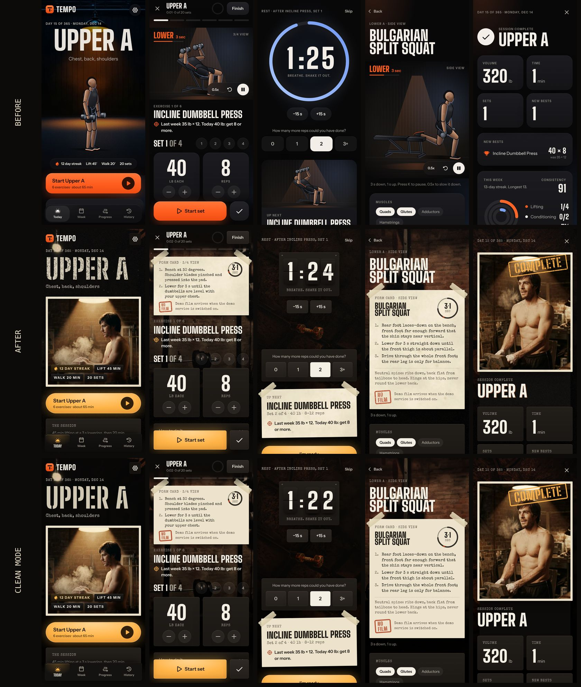
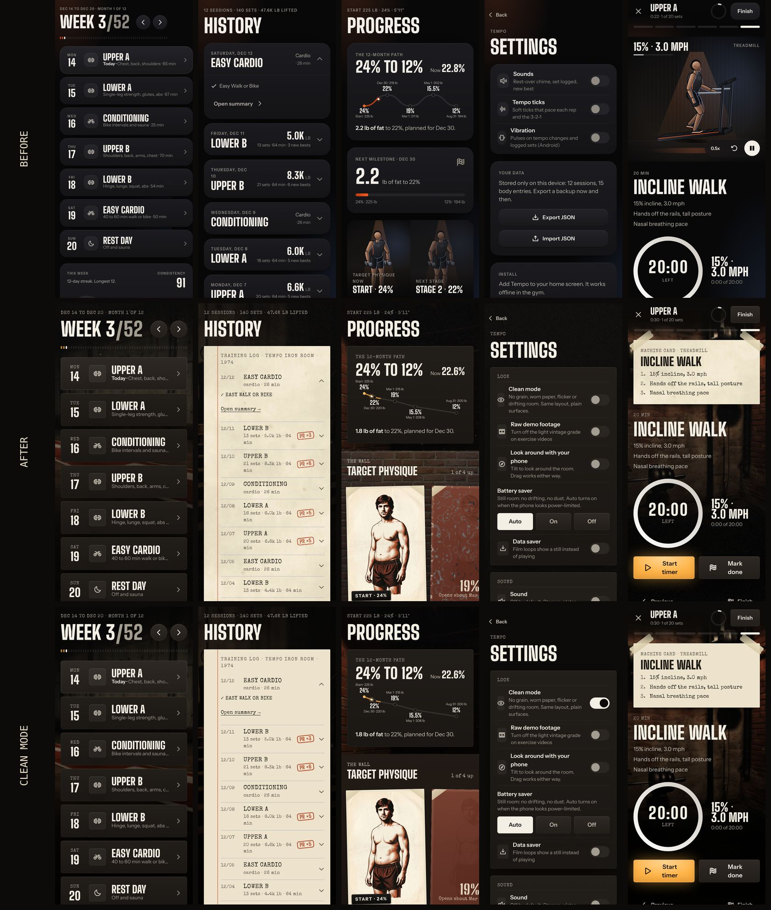

# IRON ROOM, 1974 — build report

Cold open: [cold-open.jpg](cold-open.jpg). The dropped 3D athlete: [athlete-3d-review.jpg](athlete-3d-review.jpg).
All screenshots are 390×844; full sets are produced by `npm run build && MOBILE_ONLY=1 OUT=shots/after node scripts/screenshots.mjs` (and `CLEAN=1` for Clean mode).

## Stage summaries

**Step 1, carry-over fixes (all verified by script).**
- Plan weights now use the lean-mass model: lean mass rises from 171 lb to 176 lb, and weight = lean ÷ (1 − body fat). That gives 225, 220, 215, 208 and 200 lb at the checkpoints.
- The 12-month path is one monotonic descending line. The weight chart has even 2 lb ticks and no stray legend.
- The "Back to session" bar never shows on Today and never overlaps content (`tools/session-bar-check.mjs`).
- Nothing overflows 390 px (`tools/overflow-check.mjs`).

**Stage A, MuscleWiki.**
- `server/mw-worker` is a Cloudflare Worker with a test suite. It keeps the key as a secret, mints shared 15-minute tokens, answers only your origins, limits each IP to 30 requests a minute and counts calls in KV. At 900 calls it tells the app to show form cards. The deploy guide is `server/mw-worker/DEPLOY.md`.
- The video print shows:
  - the film loading only when the exercise is on screen, front angle first, side on toggle, no preloading, paused off screen;
  - play/pause, 0.5×, and a Raw toggle for ungraded footage;
  - tape on the paper mount, never over the MuscleWiki mark;
  - loading, error and offline states.
- The form-cue card is a typed print with a chalk tempo ring. The mannequin is gone everywhere.
- Settings shows calls used this month and the required disclosure.
- Verified end to end with the real key: the Worker code ran locally, the app was built against it, metadata loaded and the token streamed. Settings read "8 / 1000".

**Stage B, the room.**
- Five Blockade panoramas in M3 Photoreal (lane and mesh retaken once each).
- One persistent three.js canvas, lazy-loaded after first paint. The warm grade and the scrim are in the shader.
- The room drifts slowly; you can drag to look around or turn on gyro look-around (the iOS permission is asked on a tap).
- Dust motes and a rare lamp flicker. It renders at 30 fps and holds still during a set, in battery saver and under reduced motion.
- Poly Haven CC0 textures: brick, mesh, rubber, rust and more. The HDRI is shipped as a 13 KB lighting map instead of 1.7 MB. Paper is procedural. Credits are in `CREDITS.md`.

**Stage C, people and props.**
- One original character. The four target-physique posters are image edits of the same reference, so he stays the same person.
- Three 16 mm Kling loops: chalking hands, resting on the bench, setting the dumbbell down. Each one's last frame matches its first, so it loops without a seam. They are 154–254 KB each.
- Tripo props: dumbbell, plate, kettlebell, each under 400 KB. They are lit by the HDRI and hang on the mesh wall as milestone plates (lit when earned, dim when not); the dumbbell floats on Rest.
- The 3D athlete was tried once and dropped as waxy.

**Stage D, sound.**
- Plate drop, stopwatch tick, split-flap flip, rubber stamp, chalk clap and lamp hum.
- A seamless 30 s room-tone loop (the API's maximum).
- Ten coach lines in Joseph Ortman's library voice.
- All off by default, with a volume slider and separate switches. The tempo calls (Lower, Press, Hold, Last rep) are synced to the tempo ring.

**Stage E, the skin and signature moments.**
- Stencil and typewriter fonts, self-hosted (OFL). Machined plates, lamp-glass buttons, prints with tape, Dymo labels and rubber stamps.
- The tab bar is a strip of rubber floor.
- Moments:
  - the cold open;
  - a DONE stamp on every set, with a thud, a pulse and the coach;
  - a rust-red PR stamp;
  - the split-flap rest clock;
  - the punch-card week;
  - the chalk tally streak;
  - the typewritten logbook;
  - the weigh-in dial with a 7-day-average needle;
  - the stencilled session name on the entrance wall;
  - the poster wall that peels open at each checkpoint.
- Clean mode and reduced motion are both supported.

**Stage F, verification.**
- Two art-director rounds plus a Clean-mode pass. Round 2 made Today's Start button reachable above the tab bar, compacted the workout form card so weight and reps sit fully above the Start-set bar, and made the set overlay opaque.
- axe WCAG 2.1 AA, contrast included: 0 violations on all 9 screens.
- Fast 4G performance, with a 4× CPU slowdown and a cold cache:

| Measure | Result |
|---|---|
| Start button visible and usable | **0.73 s** |
| Transfer before interactive | 310 KB |
| Room visible | 3.4 s, after the app is usable |
| Total first visit | 893 KB |
| Scroll on Progress (software rendering, not an iPhone) | 16.7 ms median frame, 50 ms p95 |

## MuscleWiki mapping

| # | Your exercise | MuscleWiki | ID | Match |
|---|---|---|---|---|
| 1 | Incline DB press | Dumbbell Incline Bench Press | 398 | exact |
| 2 | Chest-supported DB row | Dumbbell Laying Incline Row | 435 | exact |
| 3 | DB pullover | Dumbbell Pullover | 413 | exact |
| 4 | Incline DB fly | Dumbbell Incline Chest Fly | 399 | exact |
| 5 | DB lateral raise | Dumbbell Lateral Raise | 20 | exact |
| 6 | Incline reverse fly | Dumbbell Laying Reverse Fly | 407 | exact |
| 7 | Bulgarian split squat | Dumbbell Bulgarian Split Squat | 317 | exact |
| 8 | Single-leg DB RDL | Dumbbell Single Leg Stiff Leg Deadlift | 462 | **close**: verified on film (two DBs, free foot resting just behind); cues rewritten to match |
| 9 | DB step-up | Dumbbell Step Up | 1193 | exact |
| 10 | DB hip thrust | Dumbbell Hip Thrust | 286 | exact |
| 11 | Floor crunch with DB | Dumbbell Crunch | 563 | exact |
| 12 | Seated DB shoulder press | Dumbbell Seated Overhead Press | 45 | exact |
| 13 | One-arm DB row | Dumbbell Single Arm Row | 456 | **close**: verified on film (hand on bench, wide staggered stance, feet on the floor); cues rewritten to match |
| 14 | Incline DB curl | Dumbbell Incline Curl | 1530 | exact |
| 15 | Overhead DB triceps extension | Dumbbell Seated Overhead Tricep Extension | 16 | exact |
| 16 | Flat DB press | Dumbbell Bench Press | 377 | exact |
| 17 | DB RDL | Dumbbell Romanian Deadlift | 291 | exact |
| 18 | Reverse lunge | Dumbbell Reverse Lunge | 414 | exact |
| 19 | Goblet squat | Dumbbell Goblet Squat | 11 | exact |
| 20 | Lying reverse crunch | Laying Bent Leg Raise | 1533 | **close**: verified lying on film (arms out, knees to chest, hips curl up), so it is used. 882 "Reverse Crunch" is seated on a box and was rejected |

## Costs (COSTS.md)

| Service | Spent |
|---|---|
| fal.ai | **$2.40** of $20 (balance $12.92). Every asset was a first take |
| Blockade | 7 generations (5 + 2 retakes) |
| Tripo3D | 145 credits (3,065 left) |
| ElevenLabs | 450 credits (77,740 left this cycle) |
| MuscleWiki | about 70 calls this month |
| Poly Haven | free |

## Problems per service

- **MuscleWiki**
  - Their terms forbid hosting videos and shipping the key, so demos need the token Worker. Until you deploy it, every exercise shows its form card.
  - Video byte-range requests each count as a call. The Worker estimates 3 per playback, and the browser reports the real count afterwards.
  - Playwright's Chromium has no H.264, so actual frame playback is unverified in this environment. The token stream itself decoded fine with ffmpeg.
  - The API exposes neither your plan tier nor your remaining quota.
- **fal.ai**
  - Two cost lines were first mis-measured because jobs overlapped. They were reconciled against the real balance: $2.40.
  - Your balance was $15.32, below your $20 cap.
- **Blockade**
  - The first lane take had daylight windows and no red lane. The first mesh take had no mesh wall. One retake each fixed both.
  - Credits aren't exposed by the API.
  - M3 Photoreal comes out cleaner and cooler than "35 mm film", so the warm grade, grain and scrim are applied in the shader.
- **Tripo3D**
  - The first kettlebell had an embossed "6"; the retake is blank.
  - The athlete came out waxy and was dropped after 1 of its 2 allowed attempts.
- **ElevenLabs**
  - The subscription counter doesn't move per sound-effect call, so usage comes from the start and end totals.
  - Sound effects max out at 30 s, so the room tone is 30 s, not 60.
  - Adding the library voice used 1 of 30 voice slots.
- **Poly Haven**
  - It has no paper texture, so paper is procedural.
  - The HDRI is too heavy for a phone, so it ships as a 512×256 lighting map.

## iPhone test list

1. Open from the home-screen icon. The cold open plays once a day, runs at most 2 s and skips on a tap.
2. Today: the room drifts slowly behind the stencilled name, and the film loop plays. Start sits above the tab bar.
3. Settings: turn on Look around and tap Allow. Tilting moves the room by a few degrees; dragging sideways also works.
4. Turn on Sound and set the volume. Start a set: the coach says "Lower" and "Press" on the ring, the stopwatch ticks, and logging the set lands the stamp with the thud.
5. Rest: the ceiling zone appears, the split-flap clock clicks, the coach counts "Three, two, one", and the dumbbell turns.
6. Low Power Mode on: after a restart the room should be still (Battery saver "Auto"). Also try Battery saver "On".
7. Scroll Today, Week and Progress quickly. It should feel smooth, especially past the milestone plates.
8. Clean mode: no grain, no flicker, plain paper, and every number stays legible.
9. Settings → Accessibility → Reduce Motion: no drift, flicker or cold-open animation; fades only.
10. After the Worker is deployed:
    - the film loads only when an exercise is on screen;
    - front and side both play, and 0.5× works;
    - the MuscleWiki mark stays visible;
    - Settings → Exercise demos shows the call count rising by about 3 per film;
    - Airplane mode shows the offline form card.
11. Weigh in on Progress: the dial needle sweeps and settles, with the 7-day needle faded behind it.
12. Finish a session: the Session complete loop plays, and the Week punch card punches that day's hole on the next visit.
